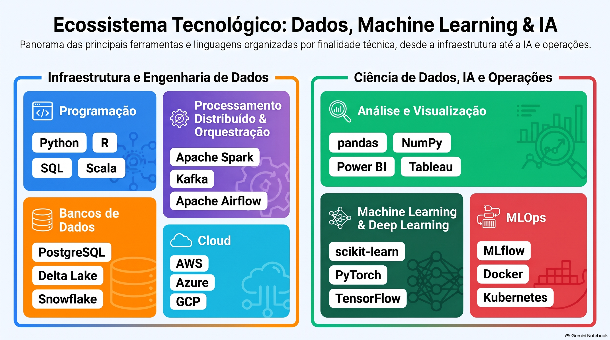

# Data Career Second Brain

## Objetivo

Investigar e compreender o ecossistema profissional de Dados, Machine Learning e Inteligência Artificial, explorando suas principais profissões e especializações, competências técnicas e fundamentos teóricos, ferramentas e tecnologias, estrutura do mercado de trabalho brasileiro e internacional, possibilidades de formação e progressão profissional, com o propósito de construir uma visão abrangente e fundamentada da área e orientar o desenvolvimento de uma trajetória profissional.

## Escopo

A pesquisa foi organizada em oito eixos:

1. Profissões e especializações.
2. Fundamentos teóricos e científicos.
3. Competências técnicas e ferramentas.
4. Arquitetura e ecossistema tecnológico.
5. Mercado de trabalho.
6. Formação e desenvolvimento.
7. Progressão e trajetória profissional.
8. Projetos, portfólio e empregabilidade.

## Metodologia e utilização do NotebookLM

O NotebookLM foi utilizado como ferramenta de apoio à investigação, permitindo consultar, relacionar e analisar um conjunto selecionado de fontes documentais.

A pesquisa foi conduzida a partir de perguntas organizadas em torno dos oito eixos, buscando construir uma compreensão abrangente do ecossistema profissional de Dados, Machine Learning e Inteligência Artificial.

### Diretriz de comportamento

O NotebookLM recebeu orientações para:

- Priorizar as fontes disponibilizadas no notebook.
- Fundamentar as respostas nos documentos selecionados.
- Apresentar citações que permitam identificar a origem das informações.
- Diferenciar informações explicitamente documentadas de interpretações e inferências.
- Reconhecer quando as fontes não são suficientes para responder a uma pergunta.
- Sinalizar divergências, limitações e possíveis desatualizações.
- Não inventar informações, referências ou evidências.
- Evitar generalizações que não sejam sustentadas pela documentação.

### Fontes utilizadas e critérios de confiabilidade

As fontes foram selecionadas considerando critérios como:

- Autoridade da instituição ou dos autores responsáveis.
- Fundamentação técnica, científica ou documental.
- Atualidade das informações, especialmente para dados de mercado.
- Relevância para os objetivos da investigação.
- Profundidade e contribuição para os assuntos pesquisados.
- Possibilidade de verificar as informações apresentadas.

Foram utilizadas documentações oficiais, publicações acadêmicas, relatórios institucionais, referenciais profissionais e estudos de mercado.

O catálogo de fontes apresenta os documentos utilizados, suas instituições responsáveis e sua relação com os eixos da pesquisa.

Consulte: [Catálogo de fontes](sources/catalogo-de-fontes.md).

### Perguntas realizadas e resultados obtidos

As perguntas foram organizadas em oito eixos de investigação e em uma etapa de integração.

| Eixo | Tema investigado | Resultado documentado |
|---|---|---|
| 01 | Profissões e especializações | [Resultados](materials/eixos/eixo-01-profissoes.md) |
| 02 | Fundamentos teóricos e científicos | [Resultados](materials/eixos/eixo-02-fundamentos.md) |
| 03 | Competências técnicas e ferramentas | [Resultados](materials/eixos/eixo-03-competencias-ferramentas.md) |
| 04 | Arquitetura e ecossistema tecnológico | [Resultados](materials/eixos/eixo-04-arquitetura.md) |
| 05 | Mercado de trabalho | [Resultados](materials/eixos/eixo-05-mercado.md) |
| 06 | Formação e desenvolvimento | [Resultados](materials/eixos/eixo-06-formacao.md) |
| 07 | Progressão e trajetória profissional | [Resultados](materials/eixos/eixo-07-progressao.md) |
| 08 | Projetos, portfólio e empregabilidade | [Resultados](materials/eixos/eixo-08-portfolio.md) |
| Integração | Relações entre os oito eixos | [Visão integrada](docs/visao-integrada.md) |

As respostas foram analisadas considerando seu conteúdo, sua fundamentação documental e as citações apresentadas pelo NotebookLM.

### NotebookLM compartilhado

Acesse o notebook utilizado na investigação:

**[Acessar notebook no NotebookLM](https://notebook.google.com/notebook/e2eee8a9-435c-485c-a9fe-0d597d5b79ec)**

## Materiais produzidos

O repositório reúne materiais originais exportados do NotebookLM e documentos organizados a partir da investigação.

Entre os materiais preservados estão:

- Relatórios e documentos de referência.
- Mapas mentais e diagramas.
- Apresentações e slides.
- Matrizes comparativas.
- Materiais de integração dos oito eixos.

Os arquivos originais exportados do NotebookLM são preservados separadamente dos documentos consolidados e organizados para consulta.

## Estrutura do repositório

```text
data-career-second-brain/
│
├── docs/
│   ├── metodologia.md
│   └── visao-integrada.md
│
├── materials/
│   ├── diagrams/
|   |   ├── arquitetura-dados-ia.png
│   |   ├── mapa-formacao-carreira.png
│   |   └── mapa-geral-ecossistema.png
|   |
│   ├── eixos/
│   |   ├── eixo-01-profissoes.md
│   |   ├── eixo-02-fundamentos.md
│   |   ├── eixo-03-competencias-ferramentas.md
│   |   ├── eixo-04-arquitetura.md
│   |   ├── eixo-05-mercado.md
│   |   ├── eixo-06-formacao.md
│   |   ├── eixo-07-progressao.md
│   |   └── eixo-08-portfolio.md
|   |
|   ├── images/
|   |   ├── ecossistema-tecnologico.png
│   |   ├── infografico-mercado.png
│   |   └── infografico-profissoes.png
|   |
|   └── presentations/
|       ├── apresentacao-geral.pptx
│       └── apresentacao-oito-eixos-pptx
│
├── sources/
|   └── catalogo-de-fontes.md
|
└──  README.md
```

### Ecossistema de Dados e IA



## Como navegar

- Comece por [docs/visao-integrada.md](docs/visao-integrada.md) para compreender o ecossistema como um todo.
- Consulte [materials/eixos/](materials/eixos/) para os resultados organizados por eixo.
- Consulte [sources/catalogo-de-fontes.md](sources/catalogo-de-fontes.md) para identificar a base documental.
- Consulte [docs/metodologia.md](docs/metodologia.md) para entender os critérios de seleção e análise das fontes.
